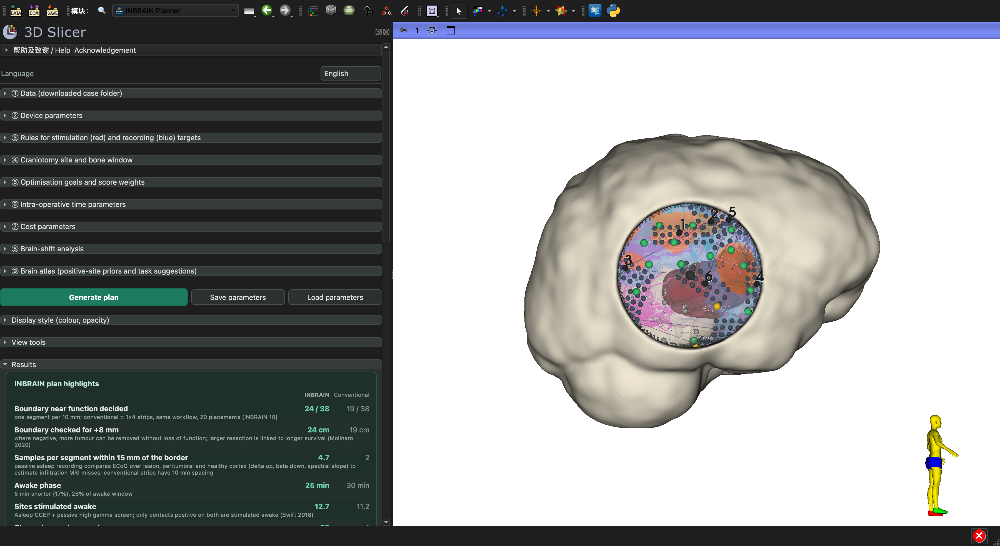

<p align="center">
  
</p>

<h3 align="center">INBRAIN Planner</h3>

<p align="center">
  A 3D Slicer extension for pre-operative planning of craniotomy site and cortical electrode-array placement in glioblastoma surgery.
</p>

<details open="open">
  <summary><b>Contents</b></summary>
  <ol>
    <li><a href="#about">About</a></li>
    <li><a href="#features">Features</a></li>
    <li><a href="#getting-started">Getting started</a></li>
    <li><a href="#usage">Usage</a></li>
    <li><a href="#repository-layout">Repository layout</a></li>
    <li><a href="#roadmap">Roadmap</a></li>
    <li><a href="#license">License</a></li>
    <li><a href="#acknowledgements">Acknowledgements</a></li>
  </ol>
</details>

## About

During awake glioblastoma surgery, functional mapping is done point by point with a hand-held probe while a 4-contact strip only records after-discharges. High-density flexible arrays such as INBRAIN's graphene array can stimulate and record at many sites at once, but nothing tells the surgeon before surgery where to place them, how many times, in what order, or how long it will take.

INBRAIN Planner answers these questions from routine pre-operative MRI, with one goal: **verify the resection boundary segment by segment**. The outline of the enhancing core (optionally FLAIR) projected onto the cortex is cut into 1 cm segments; segments near CST/AF need mapping. A segment is decided by one contact on the edge and one 8 mm outside: if both are negative, the resection can be extended without loss of function. Arrays are laid along the boundary and decide several segments at once; conventional 1×4 strips are planned with the same workflow for comparison.

> **Research use only.** Times, costs and mapping results come from a model and literature parameters, have not been clinically validated, and do not replace intra-operative neurophysiological monitoring or clinical judgement.



### Built with

* 3D Slicer 5.x (tested on 5.12.4)
* SlicerDMRI (tensor, FA, tractography) and SlicerElastix (registration)
* Python 3, NumPy, SciPy (bundled with Slicer)

## Features

**Input → computation → output**

| | |
|---|---|
| Input | Case folder (T1c, FLAIR, tumour and brain segmentation, DWI + bval/bvec); device from the library or a JSON file; target, craniotomy, time and cost parameters |
| Computation | Tensor → registration → CST/AF tractography; cortical envelope; feasible craniotomy region and entry scoring; projected resection boundary, segments and functional risk; placement scoring at every candidate position × angle (vein hinge penalty, conformity strain); greedy segment-by-segment verification; contact zoning by MRI (lesion / close / far peritumoral / healthy); same-workflow strip comparison; time (asleep CCEP + passive mapping), cost and brain-shift models |
| Output | Bone window on a (simulated) skull; placement plan with order labels and path; plan highlights versus the conventional workflow; time and cost tables; presentation figure and PDF report |

**Highlights**

- One-panel workflow from a downloaded UCSF-PDGM case folder to a placement plan, with progress bars for every step.
- **Device library** (`INBRAINPlanner/Resources/Settings/devices.json`): INBRAIN array and published specifications of commercial strips and grids; any other layout can be imported as JSON.
- **Registration check**: FA overlaid on T1c with an opacity slider, and an OK / failed verdict saved with the case and printed in the report.
- **Corridor view**: slices perpendicular to the surgical corridor; a depth slider shows the distance from the corridor axis to CST and AF.
- **Brain-shift analysis**: sinking set from tumour volume, plus lateral shift in 8 directions; coverage recomputed with electrodes kept at their planned positions.
- **Brain atlas**: registration to the Harvard-Oxford template, stimulation targets weighted by regional positive probability (Tate 2014, Sarubbo 2020), mapping tasks and tracts suggested from tumour location (Fernández Coello 2013), region of each placement.
- **Navigation export**: entry, centre, normal, long axis and corners of every placement in RAS and LPS (`.csv`, `.fcsv`).
- **Parameters saved in the scene**: reopening a `.mrb` restores the plan settings.
- **View tools**: crosshair, linked views, slices in 3D, orientation marker, re-centre, layouts.
- **Configuration files**: device library, factory display styles and regional priors in `INBRAINPlanner/Resources/Settings/`.
- **Automated test**: self-test plus a planning regression on a sample case (Reload and Test).
- **Cost model**: OR time, extra awake-phase cost and device cost per case, with the break-even array price.
- Placement order labels and path, step-by-step highlighting, configurable colours and opacity, English / Chinese interface.

## Getting started

### Prerequisites

1. Install [3D Slicer](https://download.slicer.org/) 5.x.
2. **SlicerDMRI** and **SlicerElastix** are required. If either is missing, the module downloads and installs it in the background the first time it loads (network needed) and asks you to restart Slicer; you can also install them from the Extensions Manager yourself.
3. Optional, for the brain atlas: the `space` template folder of [trajectoryGuide](https://github.com/greydongilmore/trajectoryGuideModules/releases) (only `tpl-harvardoxford/` is used).
4. Data: a case from the [UCSF-PDGM](https://doi.org/10.7937/tcia.bdgf-8v37) dataset (TCIA) or any case with the same files.

### Installation

1. Clone or download this repository to a path without non-ASCII characters.
2. Slicer → Edit → Application Settings → Modules → Additional module paths → add the `INBRAINPlanner/` folder of this repository.
3. Restart Slicer. The module appears under **INBRAIN → INBRAIN Planner**.

Keep `INBRAINPlanner/`, `INBRAINPlanner/Resources/Pipeline/` and `resources/` side by side; the module finds the algorithm and device library through relative paths.

## Usage

1. **Data**: choose the case folder, click **Preprocess**, then **Load scene** and **Check registration**.
2. **Device**: pick a preset from the library or import a device JSON.
3. **Rules and goals**: adjust target rules, craniotomy rules, coverage goals, time and cost parameters if needed.
4. **Generate plan**: about 1–3 minutes.
5. **Review**: plan highlights, plan table (click a row to see one placement), corridor view, brain-shift analysis.
6. **Export**: presentation figure, PDF report, scene.

Step-by-step operation of every control: [`../INBRAIN_Planner_Operation_Guide_EN.md`](../INBRAIN_Planner_Operation_Guide_EN.md). Methods and sources: [`docs/User_Guide.md`](docs/User_Guide.md). Command-line batch processing: [`docs/Run_Manual.md`](docs/Run_Manual.md).

## Input data

Dataset: UCSF-PDGM (TCIA, CC BY 4.0, doi:10.7937/tcia.bdgf-8v37; version 5, 2025-05-30, 142 GB): 495 pre-operative diffuse gliomas, 3 T GE Discovery 750; T1 pre/post contrast, T2, FLAIR, SWI, DWI, 3D ASL, 55-direction HARDI (with bval/bvec and clinical CSV); segmentations of enhancing, necrotic/non-enhancing and FLAIR abnormality. Dataset paper: Calabrese 2022, Radiol Artif Intell, doi:10.1148/ryai.220058. Download: https://www.cancerimagingarchive.net/collection/ucsf-pdgm/

The planner is written for **UCSF-PDGM / BraTS-style** cases. Hospital data usually need preparation first.

| Item | Required | Notes |
|---|---|---|
| T1c | yes | NIfTI, skull-stripped, ideally 1 mm isotropic |
| Tumour segmentation | yes | BraTS labels on the T1c grid: 1 necrosis, 2 oedema/FLAIR, 4 enhancing (BraTS ≤ 2021) or 3 (BraTS 2023+) |
| Brain segmentation | yes | brain mask on the T1c grid |
| FLAIR | yes | used for the optional FLAIR boundary |
| DWI + bval/bvec | for tracts | any shell and direction count supported by SlicerDMRI; without DWI there are no CST/AF tracts |
| SWI | optional | surface-vein avoidance |

File names are matched by suffix (`_T1c_bias.nii.gz` or `_T1c.nii.gz`, `_tumor_segmentation.nii.gz`, …). **Load** checks the inputs and stops with a message when the tumour labels contain no core, a mask is empty, or warns when grids differ, voxels are coarse or the skull seems not removed.

Not yet supported (planned input adapter): DICOM import and series matching, skull stripping, registration of all series to T1c, automatic tumour segmentation, atlas tracts when DWI is missing.

## Repository layout

```
INBRAIN_Planner/
├── CMakeLists.txt                  extension definition (metadata, dependencies)
├── INBRAINPlanner.png              extension icon
├── LICENSE, README.md, CHANGELOG.md
├── INBRAINPlanner/                 Slicer module
│   ├── CMakeLists.txt              installs the script and everything under Resources/
│   ├── INBRAINPlanner.py           interface (widget) and self-test
│   ├── INBRAINPlannerLib/          i18n.py (language), config.py (parameters, presets, styles, theme), logic.py (GUI-independent logic)
│   └── Resources/
│       ├── Icons/
│       ├── Pipeline/               planning core and preprocessing scripts
│       │   ├── slicer_placement_score.py   boundary segmentation, placement scoring, segment-by-segment verification, strip comparison
│       │   ├── time_model.py               awake / asleep time formulas (shared with the sensitivity script)
│       │   ├── s0_flip.py … s2_tract.py    preprocessing (gradient flip, tensor, registration, tracts)
│       │   └── run_case.sh, s3–s7          command-line batch figures and tables
│       ├── Settings/               devices.json, styles.json, eloquence.json
│       └── ExtLibs/                brain-atlas template (not in the repository, see below)
├── resources/imgs/                 README icon and screenshot
└── docs/                           User_Guide.md, Run_Manual.md
```

The brain-atlas step needs the Harvard-Oxford template folder `tpl-harvardoxford` (TemplateFlow layout). Put it in `INBRAINPlanner/Resources/ExtLibs/space/` or choose its folder in ⑨.

No patient data, templates or third-party binaries are included.

## Roadmap

- **Intra-operative module**: record where each array was actually placed and which contacts were positive, then re-plan the remaining placements.
- **Post-operative module**: compare planned and actual positions (photo or navigation registration) and report the error in millimetres.
- **Non-linear atlas registration** and a calibrated probabilistic map (e.g. built from published stimulation data) instead of regional factors.
- **Current-dependent stimulation reach** instead of a fixed radius.
- **Lock a placement and re-optimise the rest**; compare the greedy plan with an exact optimum.
- Live navigation link (OpenIGTLink) and a web viewer for sharing plans.

## License

Distributed under the MIT License. See [`LICENSE`](LICENSE).

For pre-operative planning support and research only; not a medical device. It does not replace intra-operative neurophysiological monitoring or clinical judgement.

## Acknowledgements

* Repository structure and the ideas of registration confirmation, a device library, a probe's-eye view, a scene parameter node, settings files, a view settings panel and module self-tests are inspired by [trajectoryGuide](https://github.com/greydongilmore/trajectoryGuide) (G. Gilmore, MIT License).
* Planning approach adapted from automatic SEEG multi-trajectory planning (Sparks et al., *Int J CARS* 2017; Vakharia et al. 2020).
* Data: UCSF-PDGM (Calabrese et al., *Radiology: AI* 2022), via The Cancer Imaging Archive.
* Commercial strip specifications from Rabbani et al. 2026 (ALIGNER); the first-in-human device layout from Coope et al. 2025 (NCT06368310).
* Author: Zelong Gan.

## Disclaimer

This is an independent research prototype. It is not affiliated with, endorsed by or supported by INBRAIN Neuroelectronics. "INBRAIN" is used only to name the device family the tool plans for. Device geometries in the presets are assumed, illustrative values and are not official specifications. Time and cost figures come from a model with assumed parameters; they are not clinical results.
