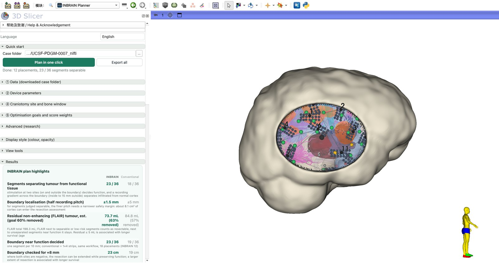
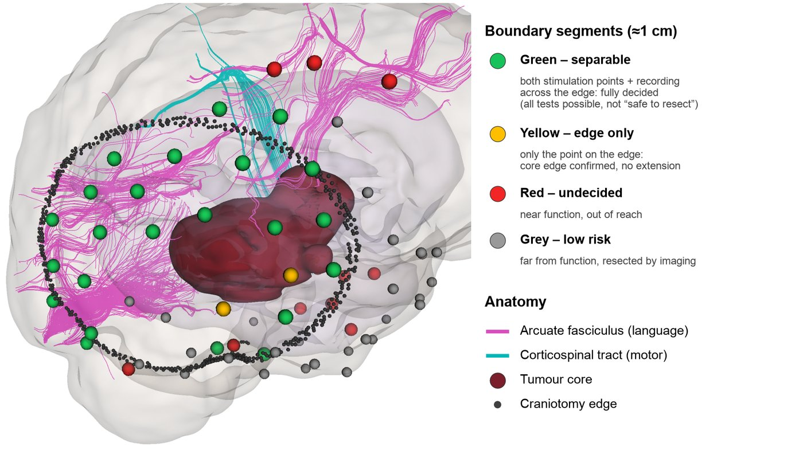
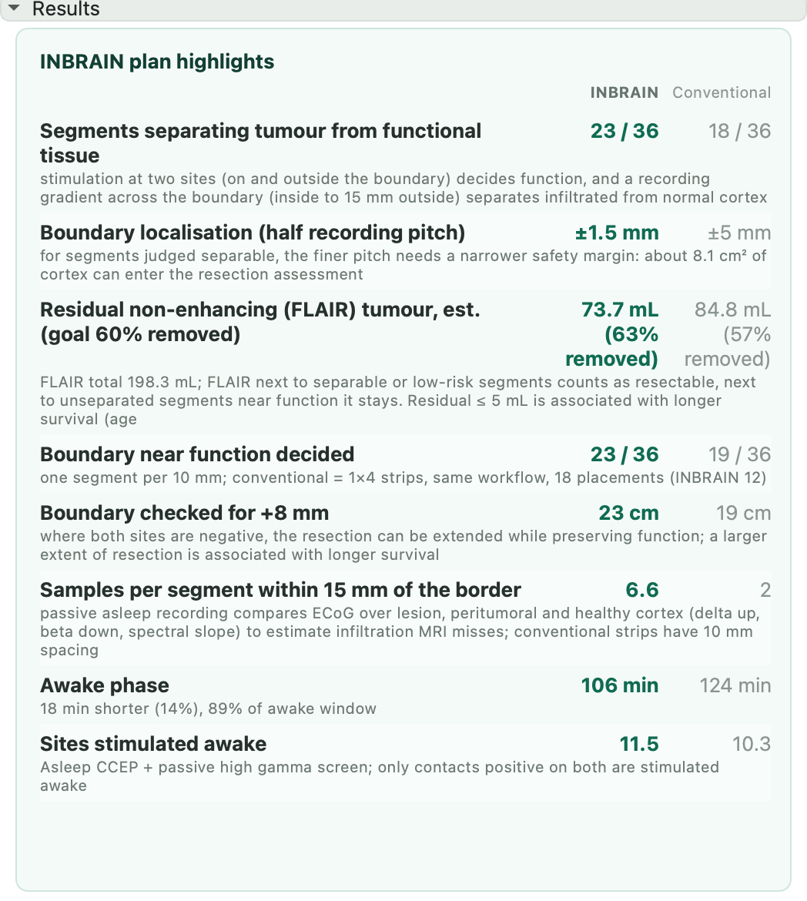
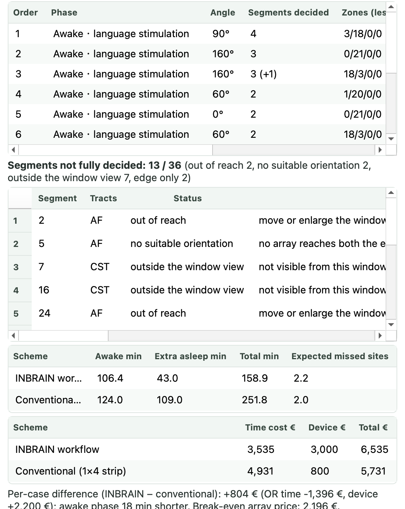
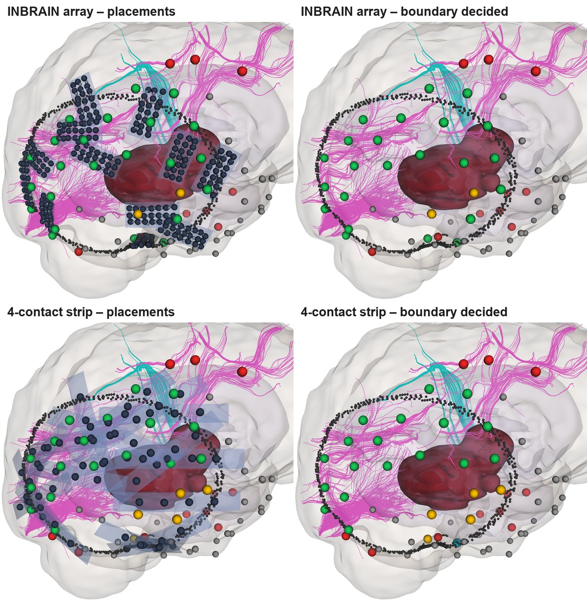
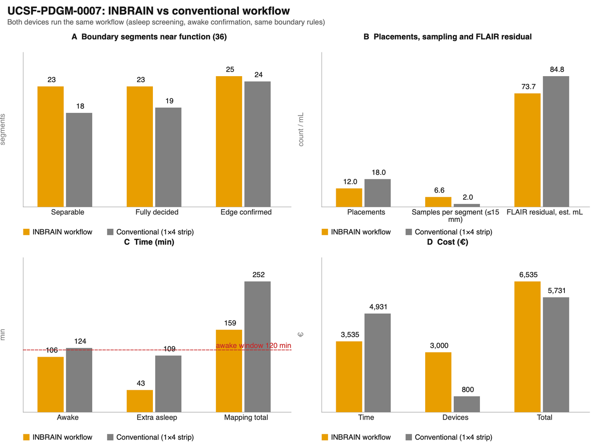
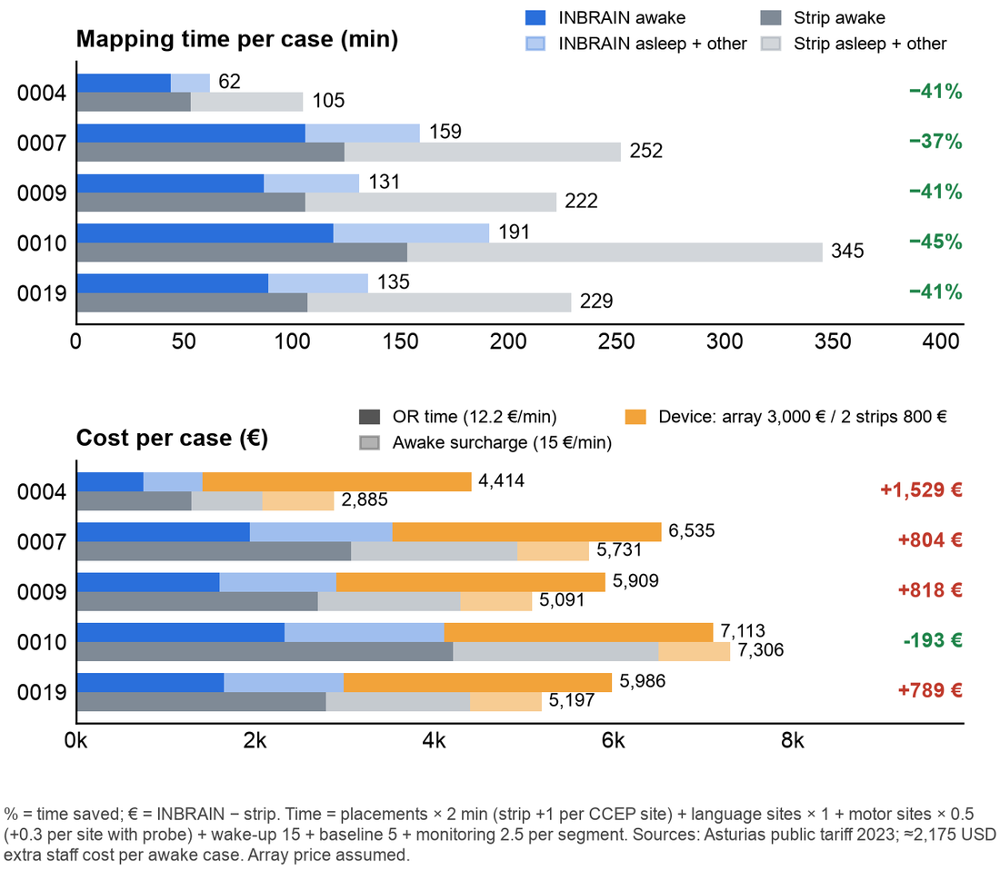

  

<h1 align="center">INBRAIN Planner</h1>

  Planning where to place brain electrodes <b>before</b> tumour surgery, so surgeons can map more of the tumour edge with fewer moves.

  <a href="https://github.com/Vive1Amour/inbrain-planner/releases/latest">Download the plugin</a> ·
  <a href="docs/Installation.md">Install and run</a> ·
  <a href="docs/User_Guide.md">User guide</a>

## In short

- **Problem:** in glioblastoma surgery, surgeons want to remove as much tumour as possible without damaging language or movement. They test the brain around the tumour with electrodes during the operation, but deciding where to put the electrodes is done by hand, one position at a time.
- **What I built:** a 3D Slicer plugin that uses each patient's MRI and nerve-fibre maps to plan, before surgery, where to place a high-density electrode array, at what angle and in what order, and compares it with today's 4-contact strips.
- **Result (5 public cases, simulated):** about **40% fewer placements** and about **40% less mapping time**; in the two largest tumours the estimated removal rose from **42% to 65%** and from **72% to 88%**, above the 60% linked to longer survival.

## Context

I developed this project in the INBRAIN Neuroelectronics Industrial Seminar at Universitat Pompeu Fabra (2026). The brief: show how INBRAIN's graphene electrode array could improve functional mapping in brain-tumour surgery, compared with devices already on the market. I turned the idea into working software: the plugin, the planning algorithm, the time and cost model and all the results below.

## The problem in plain words

Glioblastoma is the most common malignant brain tumour. Removing more of it is linked to longer survival, but the tumour often sits next to areas that control speech or movement. To find those areas, surgeons stimulate the brain surface with small electric currents while the patient is awake and see whether speech or movement is disrupted.

Today this is done with a hand-held probe, point by point, and a 4-contact strip that has to be moved many times. A high-density array has about 40 contacts that can both stimulate and record, so one placement can test much more of the tumour edge. The open question is **where to put it**. That is what this tool answers before the operation starts.

| Term | Meaning |
|---|---|
| MRI, FLAIR | Brain scans; FLAIR shows the swollen, infiltrated tissue around the tumour |
| Tractography | Reconstruction of nerve-fibre pathways from diffusion MRI |
| CST / AF | Corticospinal tract (movement) / arcuate fasciculus (language) |
| Craniotomy | The opening in the skull through which the surgeon works |
| Resection | Surgical removal of tumour tissue |

## How it works

1. **Reconstruct the anatomy.** MRI and segmentation give the brain and tumour; patient-specific tractography gives the movement and language pathways.
2. **Define the surgical area.** The tool proposes a craniotomy window and projects the tumour onto the brain surface, where electrodes sit. The projected edge is cut into 1 cm segments.
3. **Simulate placements.** The array is tried at many positions and angles, fitted to the curved surface. For each segment the tool checks whether it can stimulate on the edge and 8 mm outside it, and record on both sides.
4. **Classify each segment.** Green: all tests possible. Yellow: only the edge can be tested. Red: near function but out of reach. Grey: far from the pathways, resected by imaging.
5. **Optimise and compare.** A greedy search keeps the placements that decide the most new high-risk segments; the window is enlarged only when that clearly reduces the tumour left behind. The same plan is then run with a conventional strip in the same window.

## Inside the software

The results panel compares both devices for the case that was just planned, and lists every placement, every segment that could not be decided (with a suggested next step), and the time and cost of each workflow.

  
  

Same patient and same window, array vs strip:

One-click export of the case summary:

## Results on five public cases (UCSF-PDGM)

| Case | Placements (array / strip) | Boundary segments decided | Estimated tumour removed |
|---|---|---|---|
| 0004 | **4** / 8 | **7** / 6 of 8 | 100% / 100% |
| 0007 | **12** / 18 | **23** / 18 of 36 | **63%** / 57% |
| 0009 | **10** / 18 | **21** / 18 of 25 | **88%** / 72% |
| 0010 | **17** / 31 | **28** / 19 of 44 | **65%** / 42% |
| 0019 | **11** / 20 | 19 / 19 of 27 | 96% / 96% |

- Small tumours (0004, 0019) only save placements; large, infiltrating ones gain resection.
- At an assumed 3,000 € per array, a case costs about 800 € more than with strips; the break-even array price is about 2,200 €.

## Limitations

- These are planning-level simulations, not clinical measurements.
- Tractography is approximate, and a nerve pathway is not the same as function.
- Brain shift during surgery is only modelled, not calibrated on real data.
- Device layout, timings and prices are assumptions; all of them can be changed in the plugin.
- The gain mixes two things, contact density and built-in stimulation, which are not separated.

## Run it yourself

Download the latest plugin from [Releases](https://github.com/Vive1Amour/inbrain-planner/releases/latest), then follow [Installation and usage](docs/Installation.md). It needs 3D Slicer 5.x with the SlicerDMRI and SlicerElastix extensions (installed automatically when missing) and a UCSF-PDGM case folder.

## Roadmap

- **Intra-operative module**: record where each array was actually placed and which contacts were positive, then re-plan the remaining placements.
- **Post-operative module**: compare planned and actual positions (photo or navigation registration) and report the error in millimetres.
- **Non-linear atlas registration** and a calibrated probabilistic map (e.g. built from published stimulation data) instead of regional factors.
- **Current-dependent stimulation reach** instead of a fixed radius.
- **Lock a placement and re-optimise the rest**; compare the greedy plan with an exact optimum.
- Live navigation link (OpenIGTLink) and a web viewer for sharing plans.

## License

Distributed under the MIT License. See [`LICENSE`](LICENSE).

For pre-operative planning support and research only; not a medical device. It does not replace intra-operative neurophysiological monitoring or clinical judgement.

## Acknowledgements

* Repository structure and the ideas of registration confirmation, a device library, a probe's-eye view, a scene parameter node, settings files, a view settings panel and module self-tests are inspired by [trajectoryGuide](https://github.com/greydongilmore/trajectoryGuide) (G. Gilmore, MIT License).
* Planning approach adapted from automatic SEEG multi-trajectory planning (Sparks et al., *Int J CARS* 2017; Vakharia et al. 2020).
* Data: UCSF-PDGM (Calabrese et al., *Radiology: AI* 2022), via The Cancer Imaging Archive.
* Commercial strip specifications from Rabbani et al. 2026 (ALIGNER); the first-in-human device layout from Coope et al. 2025 (NCT06368310).

## Disclaimer

This is an independent research prototype. It is not affiliated with, endorsed by or supported by INBRAIN Neuroelectronics. "INBRAIN" is used only to name the device family the tool plans for. Device geometries in the presets are assumed, illustrative values and are not official specifications. Time and cost figures come from a model with assumed parameters; they are not clinical results.

## Author

Zelong Gan, Universitat Pompeu Fabra.
