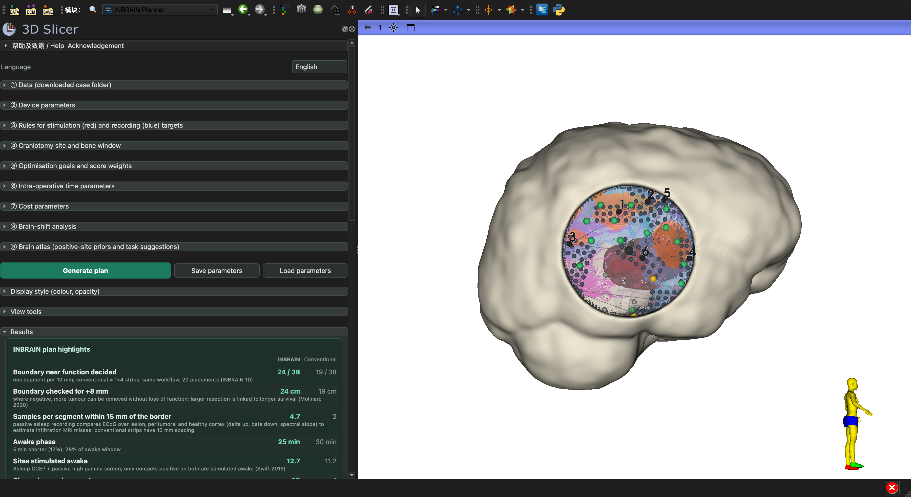

# INBRAIN Planner: 3D Slicer plugin user guide

Load a downloaded UCSF-PDGM case folder into the plugin and do everything in one panel: preprocessing (tensor, registration, tracts) → set parameters → optimise placement → review and export results. The idea is similar to molecular docking software: the brain model is the receptor, the electrode array is the ligand, the bone window is the docking box, and the score is per-segment decisions on the resection boundary and fit.

Planning goal (from v0.3): the resection boundary (default: enhancing-core edge) is projected onto the cortex in 1 cm segments; each segment near CST/AF needs an answer. A contact on the boundary plus one 8 mm outside, both negative, mean that segment can be extended by 8 mm. The array's long axis follows the boundary, so one placement decides several segments; a conventional 1×4 strip is planned with the same workflow for comparison.



Dataset: UCSF-PDGM (TCIA, CC BY 4.0, doi:10.7937/tcia.bdgf-8v37; version 5, 2025-05-30, 142 GB): 495 pre-operative diffuse gliomas, 3 T GE Discovery 750; T1 pre/post contrast, T2, FLAIR, SWI, DWI, 3D ASL, 55-direction HARDI (with bval/bvec and clinical CSV); segmentations of enhancing, necrotic/non-enhancing and FLAIR abnormality. Dataset paper: Calabrese 2022, Radiol Artif Intell, doi:10.1148/ryai.220058. Download: https://www.cancerimagingarchive.net/collection/ucsf-pdgm/

## Installation (once)

1. 3D Slicer 5.12.4 with the SlicerDMRI and SlicerElastix extensions.
2. Edit → Application Settings → Modules → Additional module paths → add the `INBRAINPlanner/` folder, restart Slicer. Prefer an ASCII-only path (e.g. a symbolic link in `~/SlicerModules/`).
3. Module list → INBRAIN → **INBRAIN Planner**.

The plugin calls the algorithm scripts in `INBRAINPlanner/Resources/Pipeline/`; keep `INBRAINPlanner/` and `INBRAINPlanner/Resources/Pipeline/` in the same parent folder.

This English edition opens in English by default. The **Language** menu at the top of the panel switches between Follow Slicer / 中文 / English; the plugin reloads and keeps the parameters and log already entered. Some messages printed by the planning core to the log are in Chinese.

## Steps

**① Data (downloaded case folder)**
- Case folder: choose `UCSF-PDGM-XXXX_nifti`; the case ID fills in automatically.
- **Output location**: by default the folder containing the case folder (or its `分析` subfolder if present); can be changed. Results go into `<case folder without _nifti>_Slicer` there, e.g. `分析/UCSF-PDGM-0007_Slicer`: preprocessing results, tracts, scene, figure, web 3D, report, navigation files and bookmarks. Slicer command-line modules need ASCII paths, so computation runs in the hidden `~/.inbrain_planner/w<case>` and is copied over automatically; if the cache is deleted it is restored from the result folder without preprocessing again.
- Tumour side: Auto-detect (by which side of the midline the tumour core lies), or set manually.
- Gradient flip: choose Auto-detect for a new case (about 10 extra minutes); UCSF-PDGM is usually z.
- Tract parameters: seed FA and stopping FA for CST and AF.
- Click **Preprocess (tensor → registration → tracts)**: tensor, registration and tractography run in the background, with progress in the log. Then click **Load scene**.
- Inputs are checked on loading: no core label in the segmentation (BraTS 1/4, or 3 in the 2023 labels) or an empty mask stops with the reason; a grid different from T1c, voxels larger than 1.5 mm, an image that looks not skull-stripped or no oedema label give a warning and continue.
- Click **Check registration**: FA is overlaid on T1c in the slice views; drag the slider to compare brain outline, ventricles and corpus callosum, then click **Registration OK** or **Registration failed**. The verdict is saved to `registration_check.txt` in the work folder and printed in the report. If it fails, change the gradient flip setting or check the data and preprocess again; tracts and the plan depend on this step.

**② Device parameters**
- Presets come from the device library `INBRAINPlanner/Resources/Settings/devices.json`: INBRAIN 3×7 + micro-contacts; the 1×4 strip described in the reference material (4 mm contacts, 10 mm); Ad-Tech 1×4 / 1×8 (2.3 mm contacts) and PMT 1×4 (3 mm contacts) as reported by ALIGNER (Rabbani 2026); a generic 4×5 grid. The source of each device is shown under the parameters. Add a device by adding an entry to the JSON file; it appears in the list after Slicer restarts.
- Adjustable: large-contact rows and columns, pitch, record-only small contacts on/off, stimulation radius, large/small contact recording radius, max fit error, rotation step.
- **Import device JSON**: any contact layout, coordinates in mm relative to the array centre:

```json
{
  "name": "INBRAIN measured",
  "large": [[-4, -12], [0, -12], [4, -12]],
  "small": [[-2, -10], [2, -10]],
  "stim_reach": 5, "rec_reach_large": 5, "rec_reach_small": 3
}
```

A grid can also be written as `{"name": "...", "nx": 3, "ny": 7, "pitch": 4, "small": true}`. **Export device JSON** writes the current device as a template.

- **Default device**: "Illustrative 3×7 + 18 array (assumed parameters)": per the reference material, about 40 contacts and 8 mm wide (same coverage as a commercial strip); one small contact sits between neighbouring large contacts along each row (patent US20240261568 also surrounds stimulating electrodes with recording ones). "Photo scale (4 mm)" is another preset.
- **Stimulation reach from current** (on by default): activation radius r = √(I/k) + contact radius (k = 1292 µA/mm², Stoney 1968; current–distance relation from Ranck 1975 and Tehovnik 1996), default 8 mA. Language segments use Penfield bipolar (two neighbouring contacts per pair, contacts and midpoint can test, radius × 0.5), motor segments Taniguchi monopolar. Parameters: current, excitability k, large contact diameter, bipolar radius factor. Unticked returns to a fixed 3 mm decision tolerance.

**③ Reference target areas (stimulation / recording)**

From v0.3 these points no longer drive placement (planning uses boundary segments only); in 3D they are translucent orange / blue patches for reference. The rules below set those patches; core-surface exclusion and tract entries still affect segment risk and where arrays may go.

- Stimulation area = distance to a tract ≤ "Max distance to tract" and distance to the lesion ≤ "Max stim. target distance to lesion".
- CST and AF weights: 0 = not a stimulation target; for right-sided cases AF defaults to 0.5, use 1 for left-sided cases.
- Recording area = distance to the FLAIR zone ≤ "Rec. target distance to FLAIR", or inside the ring around the stimulation area, and distance to the lesion ≤ "Max rec. target distance to lesion".
- **Core surface exclusion** (default 3 mm): cortex this close to the tumour core (enhancing + necrosis) is resected anyway, so it is neither a stimulation nor a recording area, and a placement with more than 10% of its large contacts over the core is not used.

**④ Craniotomy site and bone window**
- Entry point: Auto (best score in the feasible region) / cortex point closest to the tumour core / Manual (click **Place Entry point in 3D**, then click on the cortex) / **Centred on the tumour projection** (feasible cortex closest to the centre of the core; standard for superficial tumours, where the window is opened over the lesion and exposes the margin around it).
- Bone-window radius, slide under the window edge, midline exclusion and penalty zones, skull-base threshold, low-lateral penalty.
- **Score first, then fit the bone window** (on by default): the window above is the largest allowed opening; placements are chosen inside it, then the window moves between the chosen arrays and the tumour projection and its radius shrinks to 93% per step with a rerun, kept only while no segment is lost and no placement added. Elliptical and rectangular windows turn their long axis to the tumour projection's long axis (Sughrue 2016). Each step reruns the plan (about 20 s).
- **Min / max margin around tumour mm** (default 10 / 30): the window keeps at least 10 mm around the tumour's projection along the view axis (small-craniotomy definition, Carrabba 2022) and never shrinks below it; more than 30 mm exposed is flagged (tailored windows expose 2–3 cm, Sanai 2008/2009, Southwell 2016). A projection extending beyond the window is a red warning.
- **Window shape**: preset (temporoparietal ellipse, pterional oblique ellipse, parietal circle, frontal rounded rectangle) or custom: circle (radius), ellipse or rounded rectangle (length, width, long-axis angle: 0 = anterior-posterior, 90 = superior-inferior; corner radius). The shape is defined in the plane perpendicular to the brain-centre → entry direction and applies to targets in the window, the slide-under reach, placement feasibility, the window edge and the bone cut. Results show the window area and the distance from its edge to the midline, with a red warning if the edge enters the midline exclusion zone or crosses the midline, and notes for the skull base, postero-inferior and low lateral regions.
- **Surface veins (SWI)**: if the case has an SWI scan, the darkest SWI signal (lowest 0.5% of healthy brain) within 3 mm below the brain surface, outside the lesion, in blobs of at least 300 voxels are taken as large surface veins (purple layer). An entry with such a vein within 10 mm, or whose corridor passes closer than **Vein safety distance** (default 3 mm), loses **Vein penalty weight** (default 0.4; 0 ignores SWI). This is a soft penalty. The superior sagittal sinus and bridging veins are removed by skull-stripping in UCSF-PDGM, so the midline rule still stands in for them. SWI also shows haemorrhage and calcification; the lesion is masked out, but some false positives remain.

**⑤ Boundary decisions and placement**
- **Boundary segment mm** (default 10): the resection boundary is cut into segments of this length, each needing an answer; 1 cm is the usual clinical spacing for negative mapping.
- **Extended resection mm** (default 8): besides the contact on the boundary, each segment needs one this far outside; both negative → this much more can be removed.
- **Use FLAIR edge as boundary**: default is the enhancing core; ticked uses the FLAIR edge (supramaximal resection).
- **Require healthy reference contacts**: if no contact is more than 30 mm from the FLAIR border, a record-only reference array is added at the farthest position in reach (within-patient reference, Díaz-Fernández 2025); if no truly healthy cortex is reachable the checks give the actual distance.
- **Pre-operative fMRI (optional)**: a task fMRI z map (NIfTI, same space as T1c). When the maximum z 0–10 mm below a segment centre exceeds the threshold (default 3.1; twice the threshold counts as full), segment risk × (1 + weight × activation); a fully activated segment with no tract nearby also needs mapping and counts as language.
- A segment needs mapping when tract-entry cortex lies within 15 mm; risk = tract weight × atlas factor (after ⑨).
- Valid arrays: fit error ≤ max fit error; **Max strain %** (default 20): how much contact spacing may stretch or compress across the array; at most 10% of large contacts over the core; no further under the bone than the slide limit.
- Selection: each step picks the array maximising new segments × risk − vein penalty, until nothing is gained. **Fixed count** N uses exactly N placements.
- Candidate spacing: smaller is finer and slower.

**⑥ Intra-operative time parameters**: placement, language/motor sites, probe and array overheads, task recording, high gamma, CCEP, awake window, etc.; adjust to your local workflow.
- **Passive mapping asleep** (on by default): each array gets CCEP + passive auditory-task high-γ recording under anaesthesia (Swift 2018: sensitivity 0.95, specificity 0.59); awake, only arrays with suspicious contacts are revisited and stimulated.
- **Strip contacts / strip pitch** (default 4 / 10 mm): the 1×N commercial strip of the conventional workflow, planned with the same boundary workflow as INBRAIN.
- **After-discharge monitoring strip in the conventional workflow** (on by default): probe stimulation needs a separate ECoG strip next to it (reference material p5), placed once asleep and moved for every new awake region, plus one more strip in device cost. The INBRAIN array monitors itself.
- Every parameter has a tooltip in both languages with its source.

**Generate plan**: about 1–3 minutes. **Save parameters / Load parameters** store the whole parameter set as JSON for reproducing and comparing runs.

## Results

After a plan is generated, the parameter sections collapse and only Results stays open.

**INBRAIN plan highlights** (also the first table of the report), each row INBRAIN next to the conventional workflow (1×4 strip, same workflow):
- Boundary near function decided: fully decided / segments needing mapping, with the number of placements of each.
- Boundary length checked for +8 mm.
- Samples per segment within 15 mm of the border: 4 mm array pitch vs 10 mm strip pitch.
- Awake time, sites stimulated awake.

**Checks**: registration, tract counts, side, resection boundary, contact zones (lesion / close / far / healthy reference, Díaz-Fernández 2025; flagged when no healthy reference), arrays vs veins, array strain, window, awake-window use, atlas.

**Plan table**: order, phase (awake language / motor / record only), angle, segments decided ("3 (+2)" = 3 fully decided, 2 more edge only), contact zones, recording coverage, fit, strain, contacts near veins, tracts, region. **Click a row to highlight only that placement in 3D**; **Show all placements** restores the view.

**Segments not fully decided and next steps**: one row per segment with the reason and next step. **Click a row to turn the 3D view to that segment.**

| Status | Meaning | Next step |
|---|---|---|
| Outside the window view | Deep in a sulcus or on another face of the brain | Follow imaging, or confirm with ultrasound / subcortical stimulation |
| Out of reach | Outside the window and beyond the slide limit | Move or enlarge the window about X mm in a given direction |
| Edge only | Point 8 mm outside missing | Outer point exposed → one probe test; under the bone edge → add an array or change angle; out of reach → resect to the core edge only |
| No valid placement | Positions covering it fail fit, strain, core or slide limits | Use the hand-held probe; if out of probe reach, move the window |
| No suitable orientation | No array reaches both the edge and the outer point | Use the probe or move the window |
| Not placed due to veins / placement limit reached | A placement exists but the vein penalty outweighed it, or the fixed count is used | Add one array (candidate and angle given) or use the probe |

**Time table**: two rows, INBRAIN and conventional (strips, same workflow): awake, extra asleep, total and expected missed positive sites.

**Cost table**: the same two rows: time cost, devices and total, with the break-even array price.

- **Show/hide entry scores**: scores of the feasible region (green good, yellow medium, orange poor, grey excluded).
- **Save scene .mrb** and **Open result folder**: the scene, `placement_scores.csv` and `counts_*.json` are in the result folder; **Open result folder** opens it.

Colours in 3D: boundary segments green = decided, yellow = edge only, red = undecided, grey = low risk; white line = resection boundary; dark slate = large contacts, light slate = small contacts; orange patch = stimulation target area, light-blue patch = recording target area, grey patch = targets outside the window (reference only); cyan lines = CST, magenta lines = AF/SLF, dark red = tumour core, pale lavender = FLAIR zone, dark-blue dots = SWI surface veins; dark grey = entry and window edge. The orientation figure sits at the lower right; the S/I/A/P/R/L letters are hidden by default (they sit on the scene box and drift when the box is hidden); tick **Axis letters and box** in View tools to show both.

## Corridor view

**Corridor view** in Results draws the surgical corridor (cyan line) from the entry to the centre of the tumour core and turns the red slice view perpendicular to it. Drag the slider to move down the corridor: the label shows, at that depth, how far the nearest CST and AF streamlines are from the corridor axis and how much is left to the core centre. The cortical array only tests the surface; this view shows what lies along the way in depth.

## Navigation coordinates

**Export navigation coordinates** (Results) writes `<case>_plan_navigation.csv` and `<case>_plan_navigation.fcsv` to the result folder: the entry point and, for every placement, its centre, surface normal, long axis and four corners, in RAS and in LPS (the DICOM convention used by most navigation systems). The `.fcsv` point list loads into Slicer or a navigation system; the report runs the export automatically.


The same export writes **boundary segment bookmarks** `<case>_boundary_bookmarks.fcsv / .csv`: one point per boundary segment named "segment, tract, planned status" (decidable / edge only / to test / low risk), with the next step for undecided segments in the description; the csv's last column `intraop_result` is left for the stimulation result. Loaded into navigation, the points can be renamed or annotated during surgery instead of paper tags on the brain (the "digital bookmarks" from the course). In the scene they are `Boundary_bookmarks`, hidden by default.
## Parameters saved in the scene

After each **Generate plan** the full parameter set and case paths are stored in the scene. Saving the scene as `.mrb` and opening it later restores the parameters when the module is opened, so one file reproduces the plan.

## Default layout

On entering the module the left panel narrows by a quarter (drag its edge to resize) and the views switch to 3D on top with axial, sagittal and coronal MRI side by side below. Each MRI view is zoomed so the whole brain is visible (black margins at the sides are expected) and the 3D view is zoomed to the brain. **3D + three slices** in the layout menu and **Re-centre views** return to this layout.

## View tools

**View tools**: crosshair, linked slice views, slices shown in 3D, orientation marker (on by default), axis letters and box (shown together so they line up), **Re-centre views**, and a layout menu (3D only / 3D + three slices / four-up / red slice only).

## Configuration files

- `INBRAINPlanner/Resources/Settings/devices.json`: device library.
- `INBRAINPlanner/Resources/Settings/styles.json`: factory colour and opacity of every layer; **Factory style** returns to these values.

## Automated test

With developer mode on, **Reload and Test** at the top of the module runs the self-test: it checks the device library, style file and `INBRAINPlanner/Resources/Pipeline/`, then, if the 0007 case is found (or the folder in the `INBRAIN_TEST_CASE` environment variable), generates a plan and checks that at least 80% of the boundary segments reachable by arrays are fully decided, that navigation export works and that parameters are saved in the scene. Run it after changing the code.

## Brain atlas (positive-site priors and task suggestions)

**⑨ Brain atlas** needs the template folder `space` from the trajectoryGuide template package (only `tpl-harvardoxford/` is used; set its path once, it is remembered). **Register to template and label regions** registers the Harvard-Oxford template to the case T1c (rigid + affine, tumour core masked, about 10 s) and labels every cortical point with its region. Then:

- With **Weight stimulation targets by regional positive probability** ticked, the next **Generate plan** multiplies each boundary segment's risk by its region's factor (precentral 2.0; pars opercularis, posterior superior/middle temporal, supramarginal 1.8; …), so segments in high-probability areas are decided first. Factors follow Tate 2014 and Sarubbo 2020 and can be edited in `INBRAINPlanner/Resources/Settings/eloquence.json`.
- Results show the regions of cortex within 25 mm of the tumour core and, from the table of Fernández Coello 2013 / Kokkinos 2023, the functions, tasks and tracts to test; the report includes them.
- The plan table has a **Region** column with the two main regions under each placement.

The template is linearly registered; near the tumour, labels are approximate. Function is confirmed only by intra-operative stimulation.

## Input → computation → output

| | Content |
|---|---|
| Input | MRI (T1c, FLAIR), tumour segmentation, brain segmentation, diffusion (DWI + bval + bvec); device parameters; target rules; craniotomy rules; time and cost parameters |
| Computation | Tensor → registration → tracts; cortical envelope; feasible region + entry scoring → bone window; resection boundary on the cortex, segments, flag those near function; one placement at every candidate position × angle and the segments it decides; greedy selection; score-then-fit window; strips with the same workflow; contact zones, samples; undecided segments; ordering; time model; cost; brain shift |
| Output | Entry and bone window; placement plan (position, angle, order, segments); boundary decision rate and next step for each undecided segment; awake/asleep time compared with the conventional workflow; cost; scene, tables, presentation figure, PDF report, navigation coordinates |

For pre-operative planning support only; does not replace intra-operative neurophysiological monitoring or clinical judgement.

## Display style

**Display style (colour, opacity)** lists every preset layer: stimulation target area, recording target area, targets outside the window, entry point, window edge, surface veins, resection boundary, large contacts, small contacts, CST, AF, tumour core, FLAIR zone, brain surface, skull, bone flap, entry scores (good / medium / poor / excluded), placement order labels and placement path. Each row has a visibility checkbox, a colour button and an opacity slider; changes apply at once and are remembered next time. Buttons: **Set as default style** (save the current colours, opacity and visibility as your default) and **Load default style** (back to your saved default, or the factory style if none); below them **Factory style**. When a row of the plan table is clicked, the selected placement uses your opacity and the others fade.

## Skull and bone window

In **④ Craniotomy site and bone window**:
- Skull source: **Auto** (use a skull if present, otherwise simulate) / skull file (CT thresholded by HU, or a skull segmentation NIfTI, in the same space as the case MRI) / extract from MRI (non-skull-stripped images, approximate) / simulate.
- UCSF-PDGM is skull-stripped, so Auto **simulates** the skull between "distance from brain" and "distance from brain + thickness" outside the brain surface (default 4–11 mm).
- With **After optimisation, build skull and cut the bone window** ticked, each run cuts the window around the entry with the window radius; the removed bone flap is a separate, semi-transparent object. **Build skull** can be clicked at any time.
- Skull and flap colour/opacity are in Display style; the brain surface defaults to 50% opacity.

## Cost parameters

Defaults in **⑦ Cost parameters** and their sources:
- OR cost 12.2 €/min: Spanish public health tariff (Asturias 2023), 183.51 € per 15 min of surgery.
- Extra cost per awake minute 15 €: awake surgery adds about $2,175 staff cost per case (time-driven activity-based costing, 2025), spread over about 130 awake minutes.
- Array and strip unit prices: enter your purchase prices (defaults 3,000 € / 400 €).

Cost table = total time × OR cost + awake time × extra awake cost + device cost. The line below gives the per-case difference, how much shorter the awake phase is, and the break-even array price.

## Placement order and path

After a run, each placement centre is numbered (1, 2, 3…) in 3D and a dark grey line joins them in order: the route for moving the array during surgery. Numbers hidden behind the brain surface appear when the view is rotated. **◀ Previous / Next ▶** in Results highlight one placement at a time, for step-by-step explanation. Colour and opacity of the labels and path are in Display style.

## Brain-shift analysis

**⑧ Brain-shift analysis**: after opening, the cortex sinks (most at the window centre, zero at the edge of the reach), plus a lateral shift tried in 8 directions. Contacts stay at their preoperative coordinates while targets move with the tissue; stimulation coverage per tract and recording coverage are recomputed.

**Set sinking from tumour volume** is ticked by default:
- Resected core (enhancement + necrosis) < 20 ml → 5 mm, 20–40 ml → 8 mm, > 40 ml → 12 mm; +2 mm if the FLAIR oedema volume is larger than the core; lateral = sinking × 0.4.
- Basis: lesion volume is the main driver of intraoperative brain shift, and cortical displacement grows with volume (Suess 2002, groups < 20 / 20–40 / > 40 ml; Reinges 2004); oedema and tumour depth predict cortical shift at opening (Hill 1998); cortical displacement is about 1 cm on average and mainly sinking (Roberts 1998), up to 2–2.4 cm (Nimsky 2000). The millimetres per group follow these ranges and can be changed by hand.
- Suess 2002 also found strip electrodes barely move with the cortex (at most 4.2 mm vs up to 23.4 mm for the cortex), so "contacts stay, tissue moves" is a reasonable approximation.
- This part still uses the stimulation/recording target coverage (the v0.2 metric), not boundary segments. 0007 (v0.2): core 27 ml, oedema 198 ml → sinking 10 mm, lateral 4 mm; worst direction AF stimulation 96% → 92%, CST 93% → 92%, recording 83% → 79%.

## Export figure and report

- **Export figure**: captures the current 3D view (without orientation letters), adds a legend on the right (visible layers only), key numbers, and a 20 mm scale bar at the lower left (computed at the entry depth). Text follows the interface language. Saved in the work folder as `<case>_figure_en.png` (`_zh.png` in Chinese).
- **Generate report**: exports the figure, then writes `<case>_report_en.pdf` (plus .md and .html) with the checklist, plan highlights, entry, window (including the score-then-fit area change), placement plan, undecided segments and next steps, time comparison, cost, brain shift (if analysed), a full parameter snapshot and script/parameter fingerprints (which version produced it).

## Modifying the plugin

- Interface: edit `INBRAINPlanner/INBRAINPlanner.py` (UI) or `INBRAINPlannerLib/` (`i18n.py` language, `config.py` parameters and styles, `logic.py` UI-free logic and window fitting), then restart Slicer; or enable developer mode (Edit → Application Settings → Developer → Enable developer mode) and click the Reload button that appears at the top of the plugin.
- Algorithm: edit `INBRAINPlanner/Resources/Pipeline/slicer_placement_score.py` (craniotomy, boundary segments, placement, selection, strip comparison, undecided segments) or `INBRAINPlanner/Resources/Pipeline/time_model.py` (time formulas). Both are re-read on every **Generate plan**, no restart needed.
- New parameters: add a row to a `P_…` list in `INBRAINPlannerLib/config.py` (key named like the variable in the planning script); it appears in the interface and is passed in automatically. Add its English label to the `EN` table in `i18n.py` and its tooltip to `PARAM_TIPS` in `config.py`.
